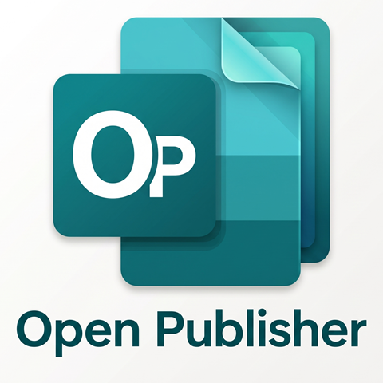

<p align="center"></p>

# OpenPublisher

Logiciel libre de mise en page (PAO) pour remplacer Microsoft Publisher au quotidien : affiches, journaux de classe, lettres aux parents, invitations, diplômes… Pensé pour les enseignants. Interface en **français, anglais et arabe**.

**Version en ligne :** <https://houssemeddinelassoued.github.io/OpenPublisher/>

## Fonctionnalités

**Création**
- 8 modèles prêts à l'emploi (affiche, journal avec page maître, fiche d'exercices, lettre aux parents, invitation, diplôme, tableau de comportement, emploi du temps)
- Texte, images, tableaux, cadres décoratifs, numéros de page, multi-pages (A4, A5, A3, Letter, sur mesure)
- **Plus de 45 formes** : polygones, étoiles, flèches, bulles, symboles (cœur, nuage, éclair, smiley…)
- Pages **portrait et paysage dans le même document**
- Coller des images depuis le navigateur, le bureau, PowerPoint ou Paint (Ctrl + V), ou les glisser-déposer sur la page
- **Modèles personnels** créés à partir d'un document, d'une page ou de pages sélectionnées

**Mise en page avancée**
- Rotation 0–360° par poignée (Maj = pas de 15°)
- Sélection multiple (Ctrl ou Maj + clic, ou rectangle de sélection), alignement et répartition
- Sélection de plusieurs pages (cases à cocher, Ctrl + clic) : dupliquer, supprimer, orientation, impression, modèle
- Menu contextuel (clic droit), historique Annuler / Rétablir complet, ruban masquable (Ctrl + F1) avec zoom ajusté automatiquement à l’écran
- Repères intelligents magenta (centre et bords de la page, marges, autres objets)
- Déplacement au clavier (flèches, Maj = 10 px)
- **Cadres de texte liés** : le texte en trop continue automatiquement dans le cadre suivant, même sur une autre page (flèches de chaînage, indicateur « + » de dépassement)
- **Page maître** : en-tête, pied de page, filigrane et numéro de page répétés sur toutes les pages (masquable page par page)
- **Fond perdu 3 mm, traits de coupe et repères d'enregistrement** à l'écran et à l'export

**Impression et fichiers**
- Export PDF / impression et PNG en **300 dpi**
- **Import fidèle des fichiers Publisher (`.pub`, Publisher 2002 à 2021)** : nombre de pages, format et orientation, position et taille de chaque objet, textes mis en forme (polices, tailles, couleurs, gras, exposants, puces, retraits, interlignes, alignements), tableaux (cellules fusionnées, fonds, bordures), images recadrées, groupes, page maître
- Import Word (`.docx`) et HTML (texte)

**Organisation**
- Bibliothèque personnelle avec dossiers et sous-dossiers, glisser-déposer, favoris et accès rapide
- Historique des documents sur 12 mois, classé (aujourd'hui, hier, cette semaine, par mois)
- Versions automatiques de chaque document (à l'ouverture, toutes les 10 min, à la fermeture), restaurables ; les versions de plus d'un an sont supprimées
- Sauvegarde globale en un seul fichier **`.opb`** (documents + dossiers + versions), avec rappel hebdomadaire
- Versions compressées et images stockées une seule fois (documents lourds sans saturer l’ordinateur)
- Fonctionne **hors ligne** ; les documents restent sur l'ordinateur (IndexedDB)
- Installable comme une application (PWA) depuis Chrome ou Edge

## Installer comme une application

Ouvrez la version en ligne dans Chrome ou Edge, puis : menu ⋮ → **Installer OpenPublisher**. Une icône apparaît sur le bureau.

## Développement

Prérequis : Node.js 18+.

```bash
npm install
npm run dev       # http://localhost:5173
npm run build     # production dans dist/
```

Structure :

| Dossier | Rôle |
| --- | --- |
| `src/core/` | Modèle de données, IndexedDB, moteur de texte enrichi (cadres liés, arabe), rendu 300 dpi |
| `src/core/cfb.ts`, `pubformat.ts`, `pubimport.ts` | Lecture du conteneur OLE2 et du format Publisher, conversion en document OpenPublisher |
| `src/editor/` | Éditeur (ruban, canevas, poignées, repères, inspecteur) |
| `src/pages/Hub.tsx` | Accueil, bibliothèque, historique |
| `src/i18n.tsx` | Traductions FR / EN / AR |
| `src/templates.ts` | Modèles |

Stack : React, TypeScript, Vite, Tailwind CSS v4, lucide-react.

## Limites connues

- Import `.pub` : les images EMF/WMF/TIFF sont remplacées par un cadre gris, les formes de découpe d’images (coins arrondis…) et la BorderArt ne sont pas reprises ; les polices absentes de l’ordinateur (ex. Twinkl) sont remplacées par une police proche. Les fichiers Publisher 98/2000 sont importés en texte seul.
- L'export PDF est composé d'images 300 dpi (le texte n'est pas sélectionnable).
- Le contenu des modèles est rédigé en français.

## Équipe

- **Houssem Eddine Lassoued** — conception et développement
- **Hela Sahli** — idée et expérience utilisateur

Une initiative **NQ Open Initiative** de **National Quantum** (Consulting · Software Development · Training).
Collaboration ou projets futurs : [houssemeddine.lassoued@gmail.com](mailto:houssemeddine.lassoued@gmail.com)

Licence [MIT](LICENSE).
